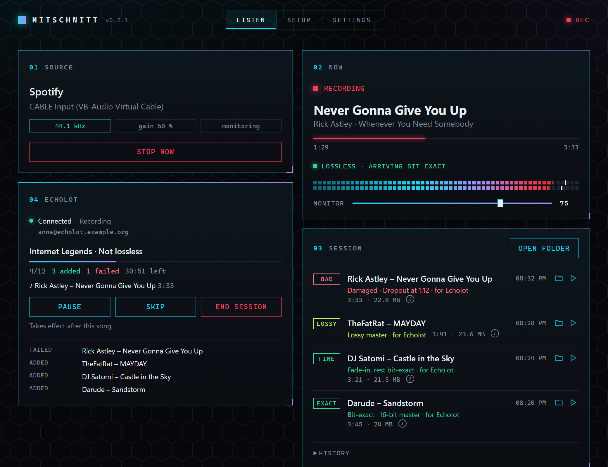

<h1 align="center">
  <br>
  Mitschnitt
</h1>

<p align="center">Records what your music app plays, bit for bit, and checks that the file really is the original.</p>

<p align="center"></p>

Mitschnitt runs next to your music app. Play a song from the start and it lands in its own file, from the first
sample to the last. Then Mitschnitt checks the file and tells you whether the capture was flawless.

I built it because you can rarely tell whether a recording really is lossless. Most recorders take whatever comes
out of the sound card and hope for the best. Mitschnitt takes the app's own stream before Windows or PipeWire touch
it, and the check tells you when something got in the way, like a lossy stream, an equalizer or a dropout.

It's a hobby project that I use every day on Windows and Linux, and it has been tested and fine-tuned a lot. If you
still find a bug, please [open an issue](https://github.com/Zweisteinium/mitschnitt/issues).

Large parts of the code were written with AI assistance (Claude Code).

## Features

- **Bit-exact.** Only the app's own stream is recorded, before the system mixes, resamples or changes its volume.
- **Checked live.** Every sample is checked as it arrives, so a lossy stream or an equalizer shows up while the song
  still plays.
- **Whole songs.** From the start of the song to Spotify's pause after it. A pause, skip, seek, stall or dropout is
  caught, so a broken recording never passes as complete.
- **Labeled.** Each file is decoded again, compared with the recording and gets a label with the reason.
  - **EXACT.** Every sample with sound is bit-exact.
  - **FINE.** Bit-exact apart from Spotify's fade-in at the very start (see [Limits](#limits)).
  - **LOSSY.** The song only exists lossy, as Spotify's stream or in its master. Saved as MP3 when you record
    yourself.
  - **ALT.** Something isn't original, or the end couldn't be proven.
  - **BAD.** Damaged, for example by a dropout.
- **Formats and tags.** FLAC in 16 or 24 bit as the source was, WAV or MP3. Tags and cover are filled in, file names
  follow your template, and songs you already have are skipped.
- **Auto setup.** Checks [Spotify's settings](#spotify-settings). On Windows it also installs VB-Cable and routes
  Spotify into it.
- **Song lists.** With [Echolot](#echolot), Mitschnitt records a whole list of songs on its own, connected or from a
  list exported from Echolot.
- **Media key protection.** Media keys, headset buttons and earbuds that pause when you take them out are held back
  while Mitschnitt listens. Spotify's own pause button still works. The hook only looks at media keys.
- **No sleep.** The computer stays awake while Mitschnitt listens. The screen still turns off and locks.

|  | Windows | Linux |
|---|:---:|:---:|
| Bit-exact recording, live check, whole songs | ✓ | ✓ |
| Labels, formats and tags | ✓ | ✓ |
| Auto setup | ✓ | ✓ |
| Song lists with Echolot | ✓ | ✓ |
| Media key protection | ✓ | |
| No sleep | ✓ | ✓ |

## Download

Get the latest version from [Releases](https://github.com/Zweisteinium/mitschnitt/releases/latest).

- **Windows 10/11.** Installer (no admin rights) or portable single file. Spotify plays through VB-Cable, which the
  Setup tab installs for you. You can also get it yourself from [VB-Audio](https://vb-audio.com/Cable/)
  (donationware). The builds aren't code-signed, so SmartScreen asks once. Click More info, then Run anyway.
- **Linux.** A .deb for Debian 12, Ubuntu 22.04, Mint 21 and newer, and an AppImage for anything else with glibc
  2.36 or newer, like Fedora 37 or Arch. Both need PipeWire, which Ubuntu 22.04 doesn't use by default. The
  AppImage also needs WebKitGTK 4.1, the browser engine the interface runs on (`webkit2gtk4.1` on Fedora,
  `webkit2gtk-4.1` on Arch). The .deb installs it for you.
- **macOS.** Planned, low priority.

## Spotify settings

For lossless, bit-exact recordings, a few Spotify settings need to be right. Several of them change every song
before it reaches the file. You wouldn't hear most of it, but the file would no longer be the original.

| In Spotify's settings | Set to | Otherwise |
|---|---|---|
| Audio quality → Streaming quality | Lossless (Premium) | lossy audio |
| Audio quality → Auto adjust quality | Off | lossy audio when the network is slow |
| Playback → Normalize volume | Off | changes the level of every song |
| Playback → Equalizer | Off | changes every sample |
| Playback → Crossfade | Off | mixes the end of a song into the next one |
| Playback → Automix | Off | blends song transitions |
| Exclusive mode (Windows) | Off | nothing can be recorded |

The Setup tab checks all of them except crossfade, which Spotify 1.3.4 moved out of its settings file. Please check
that one yourself. If the settings file gains a setting Mitschnitt doesn't know, or two recordings in a row don't
arrive bit-exact, a banner asks you to look at these settings.

## Good to know

- **Spotify Premium is recommended.** Only Premium streams lossless, which means the file holds exactly the audio
  Spotify sends. Without it, Mitschnitt still records, labels the file LOSSY and saves it as MP3.
- **Recording takes as long as the song.** A 3 minute song takes 3 minutes.
- **Play songs from the start and let them finish.** A song you skip, seek in or pause isn't saved, so no broken file
  ends up in your library.
- **Your volume doesn't matter.** Listen as loud or quiet as you like with Mitschnitt's monitor slider. Only
  Spotify's own volume slider is held in place while Mitschnitt listens. Song lists are recorded silently.

## How it works

The system can change the audio too. Most volume levels change every sample, another sample rate means resampling,
and the Windows mixer limits loud songs. Mitschnitt keeps all of that out while it listens.

On **Windows** Spotify plays into a silent virtual cable, and Mitschnitt plays it back to you. Spotify's volume sits
at exactly 50 %, which keeps the Windows peak limiter away from loud masters. Halving a sample is exact, so
Mitschnitt doubles it again and gets the original back.

On **Linux** Mitschnitt records straight from Spotify's PipeWire stream, so there is nothing to install. Spotify
plays into a virtual output of Mitschnitt, which plays it back to you. Spotify's volume is held at 100 % and
PipeWire runs at 44.1 kHz. All of it goes back to how it was when you stop.

On both systems an untouched 16 or 24 bit source arrives as exact 24 bit values, and Mitschnitt checks every sample
for that. The end of a song is found in the samples too, since the length Spotify reports can be a few milliseconds
short.

Recording in real time is slower than a downloader, but you get exactly the version Spotify plays, not some upload
that might be a different edit.

## Echolot

[Echolot](https://github.com/Zweisteinium/echolot) is my other project, a self-hosted music library that syncs your
playlists and likes and keeps each song in the best quality it can get. Connected to it, Mitschnitt records the
songs Echolot is still missing. It starts each one in Spotify, checks that the right song plays, records it and
uploads it. EXACT and FINE recordings go up, and so do lossy ones (a lossy master, or a song Spotify only streams
lossy), which Echolot judges with its own spectrum check. A damaged recording is tried again.

While a song records, Spotify is set to repeat it. The pause before the repeat proves where the song ends, even on
gapless albums, and your repeat setting comes back afterwards. If crossfade is on, Mitschnitt hears it, pauses the
list and asks you to turn it off.

You can keep using your PC meanwhile. On Windows, when Spotify grabs the focus for a new song, Mitschnitt gives it
back. On Linux the desktop decides whether Spotify may come to the front.

## Coming from Spytify?

[Spytify](https://github.com/jwallet/spy-spotify) by jwallet has been the go-to Spotify recorder for years and
showed how well recording instead of downloading can work. Mitschnitt picks up some of its long open issues, like
lossless FLAC and 24 bit instead of MP3, clean starts without the tail of the previous song, dropouts caught
instead of saved, and Linux.

## Limits

- **Spotify only.** An app only gets a profile once its output has been proven untouched. If you ask nicely, I'll
  try Deezer, Apple Music or whatever your heart is after next <3
- **Spotify's fade-in.** Now and then Spotify fades in the start of a song, over 10 to 12 ms. It happens for a few
  percent of songs, and what triggers it isn't known yet. Mitschnitt finds the fade exactly, checks that everything
  after it is bit-exact and labels the file FINE. You can't hear it, and it is the only difference Mitschnitt
  accepts. Apart from that, only the digital silence at the very start and end can be a few milliseconds longer or
  shorter than in the original. The sound itself is never cut.
- **Gapless albums.** When one song flows into the next, there is no pause to cut at. A song without a pause before
  it is skipped, because there is no exact start. A song without a pause after it is saved as ALT ("end not
  verified"), because a skip in its last moments would look the same. Song lists with Echolot avoid this with
  Spotify's repeat.

## Your account(s)

Mitschnitt doesn't download or decrypt songs, doesn't speed up playback and doesn't use an unofficial client, the
things that have gotten accounts flagged. Songs play in the official Spotify app at normal speed, just like when you
listen yourself, and Mitschnitt records what comes out. Keep the recordings for your own listening. As with any
open source tool, you use it at your own discretion and without warranty.

## Building

```sh
cargo test --workspace --exclude mitschnitt-app
cd app && npm install && npx tauri build
```

On Linux you also need the PipeWire headers and libclang (`pipewire clang` on Arch, `libpipewire-0.3-dev
libclang-dev` on Debian and Ubuntu) and the usual [Tauri prerequisites](https://v2.tauri.app/start/prerequisites/).
`make test-live` checks the capture against your running PipeWire without making a sound. `make linux` builds the
AppImage and the .deb in a Debian 12 container.

`crates/core` does the capture, the checks and the file writing, with the platform specific parts in
`crates/core/src/platform`. `crates/cli` is a command line tool with `check`, `setup` and `listen`, and its check
also works on FLAC files Mitschnitt didn't make. `app` is the desktop app, built with Tauri 2 and Svelte 5.

## License

[GNU AGPL v3](LICENSE)
